# 5-Bit Carry Look-Ahead Adder — Full-Custom VLSI to FPGA

A 5-bit **Carry Look-Ahead (CLA) adder** designed end to end: transistor-level schematics in **NGSPICE**, full-custom layout in **MAGIC** (180 nm, SCMOS rules), post-layout extraction, structural **Verilog** with simulation, and implementation on **FPGA** (Basys 3 / Nexys A7).

> Course project for **VLSI Design**, Monsoon 2025, IIIT Hyderabad (Prof. Abhishek Srivastava, CVEST).
> 📄 **[Read the full project report (PDF)](docs/report.pdf)** · Problem statement: [`course_project_vlsid2025.pdf`](course_project_vlsid2025.pdf)

<p align="center">
  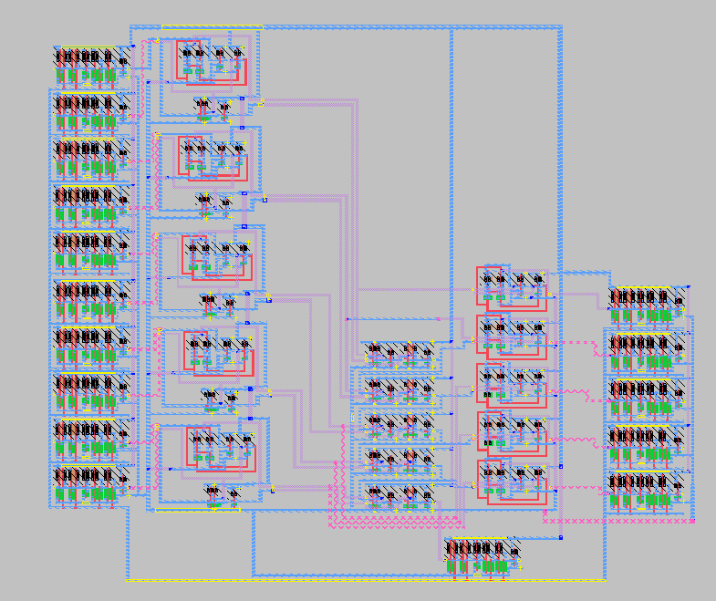
  <br><em>Full-custom MAGIC layout of the complete registered 5-bit CLA adder</em>
</p>

## Key Results

| Metric | Pre-layout | Post-layout |
|---|---|---|
| Clock → S0 delay | **325.6 ps** | **414.9 ps** |
| D-FF clock-to-Q (rising) | 25.6 ps | — |
| D-FF hold time | 52.9 ps | — |
| D-FF setup time (fall / rise) | 25.0 ps / 30.5 ps | — |
| D-FF Q rise / fall time | 91.6 ps / 261.4 ps | — |

Functionality was confirmed at every level: NGSPICE, post-layout extraction, Icarus Verilog, and on FPGA hardware with an oscilloscope.

---

## Architecture

The adder is pipelined between input and output registers. Operands are latched on one rising clock edge, and the sum/carry-out are captured on the next.

```
           5            ┌──────────────────────────── 5-bit CLA adder ────────────────────────────┐
  a ──/──▶ [D-FF] ──▶   │  ┌────────────┐  P   ┌───────────────┐ carry  ┌────────────┐            │ ──▶ [D-FF] ──▶ sum (5)
           5            │  │ Propagate &│ ───▶ │  Carry Look-  │ ─────▶ │ Sum block  │ ── sum ──▶ │
  b ──/──▶ [D-FF] ──▶   │  │ Generate   │  G   │  Ahead (CLA)  │        │ (XOR)      │            │ ──▶ [D-FF] ──▶ cout
                        │  └────────────┘ ───▶ └───────────────┘        └────────────┘            │
                        └─────────────────────────────────────────────────────────────────────────┘
  clk ───────────────────────────── shared by all flip-flops ──────────────────────────────────────
```

### Equations (c<sub>0</sub> = 0)

| Signal | Expression |
|---|---|
| Propagate | p<sub>i</sub> = a<sub>i</sub> ⊕ b<sub>i</sub> |
| Generate | g<sub>i</sub> = a<sub>i</sub> · b<sub>i</sub> |
| Carry | c<sub>i+1</sub> = g<sub>i</sub> + p<sub>i</sub> · c<sub>i</sub> |
| Sum | s<sub>i</sub> = p<sub>i</sub> ⊕ c<sub>i</sub> |

<p align="center">
  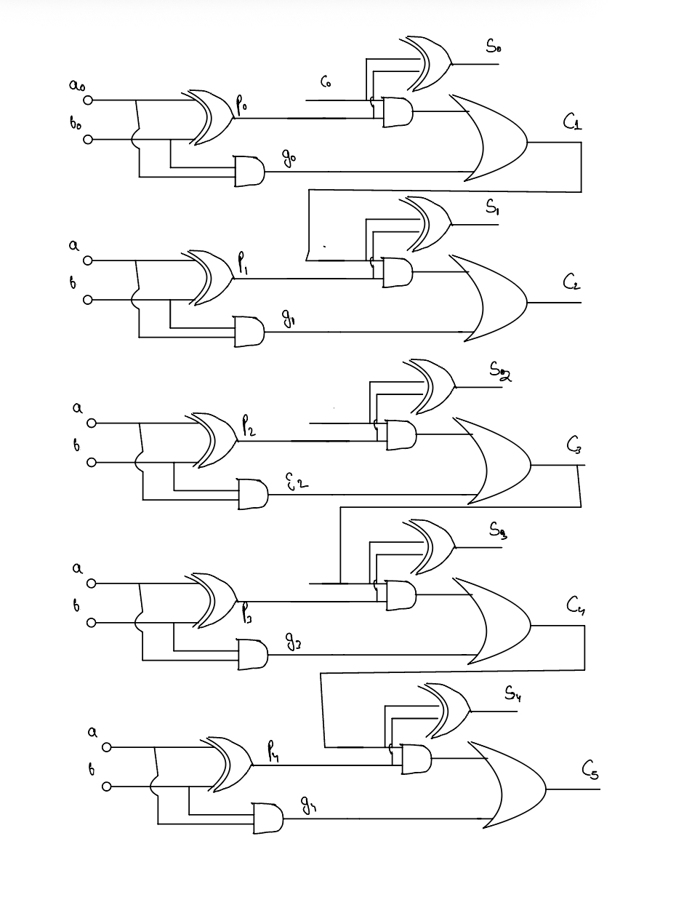
  <br><em>Gate-level structure: P/G (XOR + AND), carry (AND-OR) and sum (XOR) per bit</em>
</p>

In the Verilog model each carry is fully expanded in terms of `p`, `g` and `cin`. For example:

```
c5 = g4 + p4·g3 + p4·p3·g2 + p4·p3·p2·g1 + p4·p3·p2·p1·g0 + p4·p3·p2·p1·p0·cin
```

---

## Circuit Design (180 nm, V<sub>DD</sub> = 1.8 V)

- **Technology:** TSMC 180 nm BSIM3 models (`TSMC_180nm.txt`), λ = 0.09 µm, L = 2λ for all devices
- **Sizing:** W<sub>n</sub> = 10λ, W<sub>p</sub> = 20λ (W<sub>p</sub>/W<sub>n</sub> = 2 to balance rise and fall)
- **Logic style:** static CMOS

| Block | Implementation |
|---|---|
| Inverter | Standard CMOS |
| NAND / NOR | 4-transistor static CMOS |
| AND / OR | NAND / NOR followed by an inverter |
| XOR | Transmission-gate XOR with input inverters |
| P/G block | XOR (p) + AND (g) per bit |
| Carry block | AND-OR cell per bit: c<sub>i+1</sub> = g<sub>i</sub> + p<sub>i</sub>·c<sub>i</sub> |
| Sum block | XOR per bit |
| D flip-flop | TSPC (true single-phase clock), positive-edge triggered, plus an output inverter |

The TSPC flip-flop has three stages driven by a single clock. The input is sampled while the clock is low and held when it goes high. The output stage precharges during the low phase and evaluates during the high phase, which makes the flip-flop positive-edge triggered without needing a complementary clock.

The flip-flop testbench measures **clock-to-Q delay, setup time and hold time** using `.measure` statements.

---

## Results

### D flip-flop (TSPC)

<p align="center">
  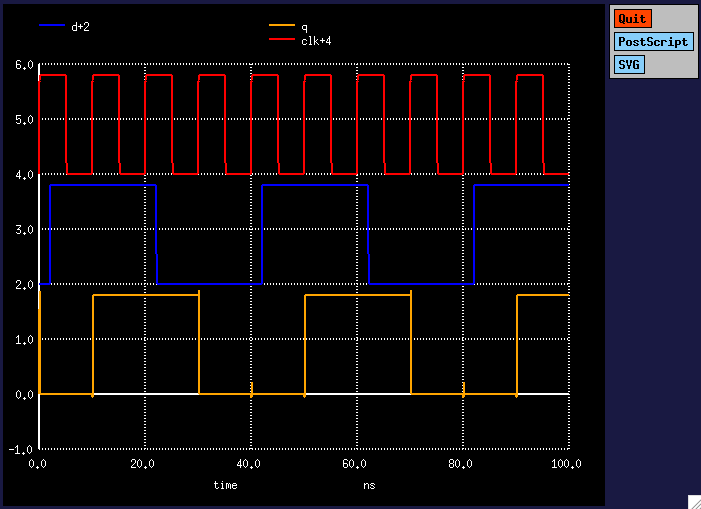
  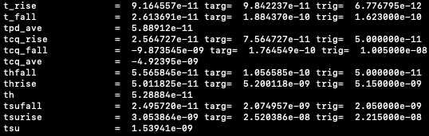
</p>

### Layout (MAGIC, SCN6M_DEEP.09)

| Inverter | NAND | NOR |
|:-:|:-:|:-:|
| 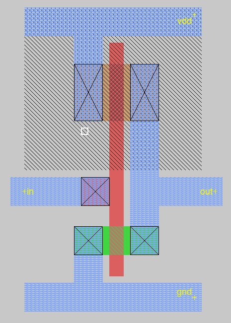 | 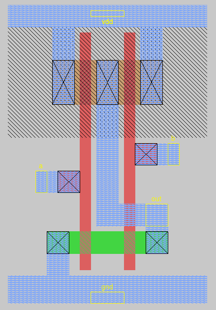 | 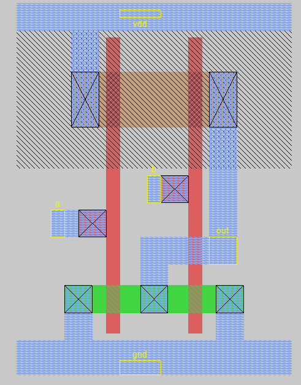 |

| Transmission-gate XOR: layout | Transmission-gate XOR: stick diagram |
|:-:|:-:|
| 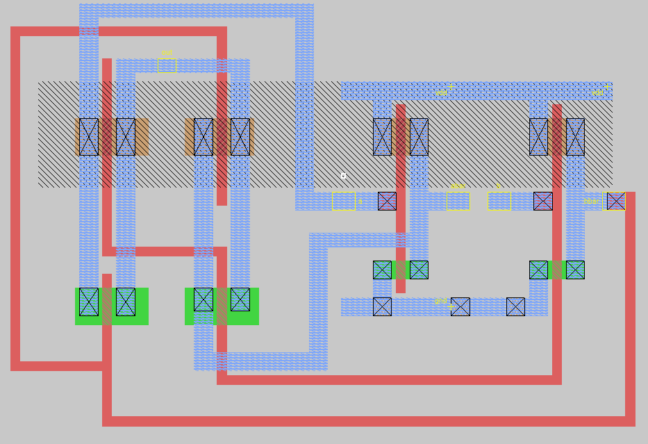 | 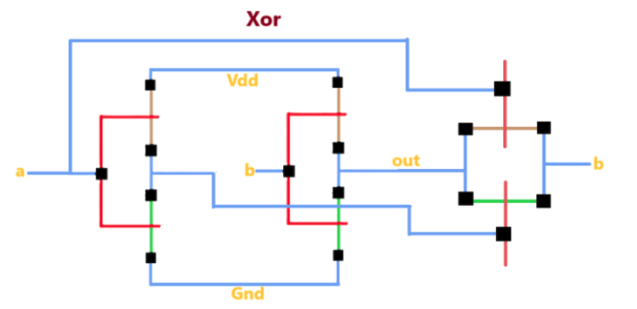 |

### Full adder: pre-layout vs. post-layout

Test case: **A = 10101, B = 11000** (cin = 0), simulated in the registered adder. Each panel shows one bit position (inputs, flip-flop outputs, sum and carry).

**Pre-layout (schematic netlist)**
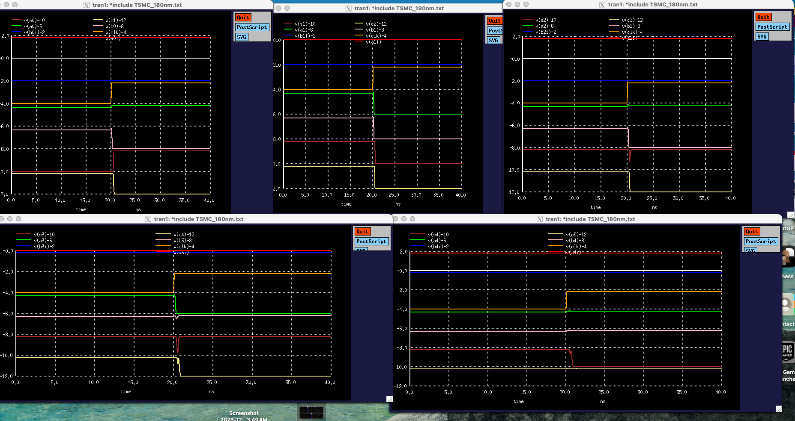

**Post-layout (extracted from `finalcircuit.mag`)**
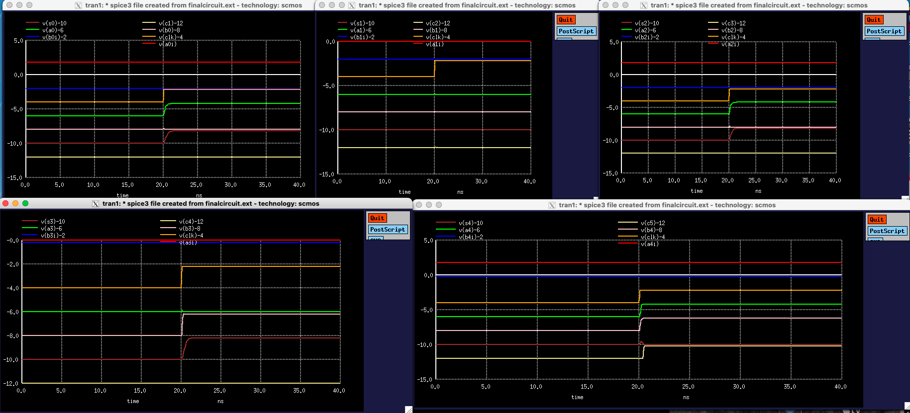

The sum outputs agree before and after layout. Parasitic R/C from extraction raises the clock-to-S0 delay from 325.6 ps to 414.9 ps, about 27% higher, and makes the edges visibly softer.

### Maximum clock frequency

For a register-to-register path:

```
T_clk(min) = t_cq + t_CLA(max) + t_setup        f_max = 1 / T_clk(min)
```

### FPGA hardware (Keysight EDUX1052A oscilloscope)

| S4 = 1 (≈ 3.4 V) | C5 = 0 (≈ 0.2 V) |
|:-:|:-:|
| 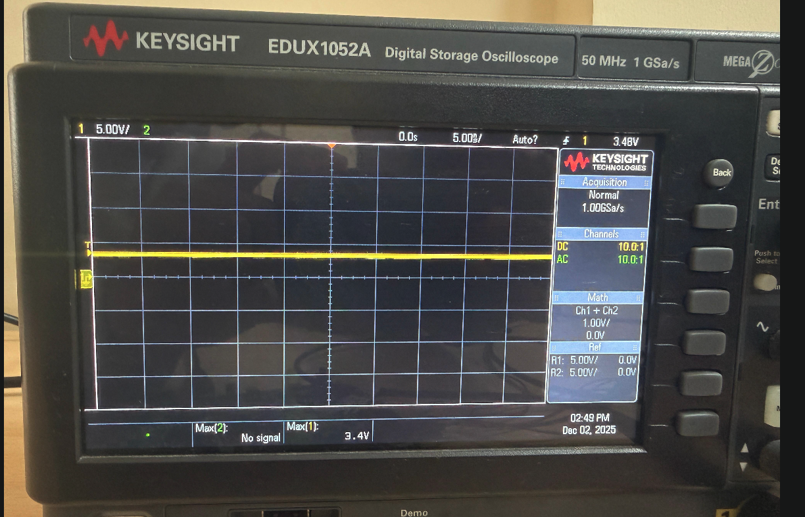 | 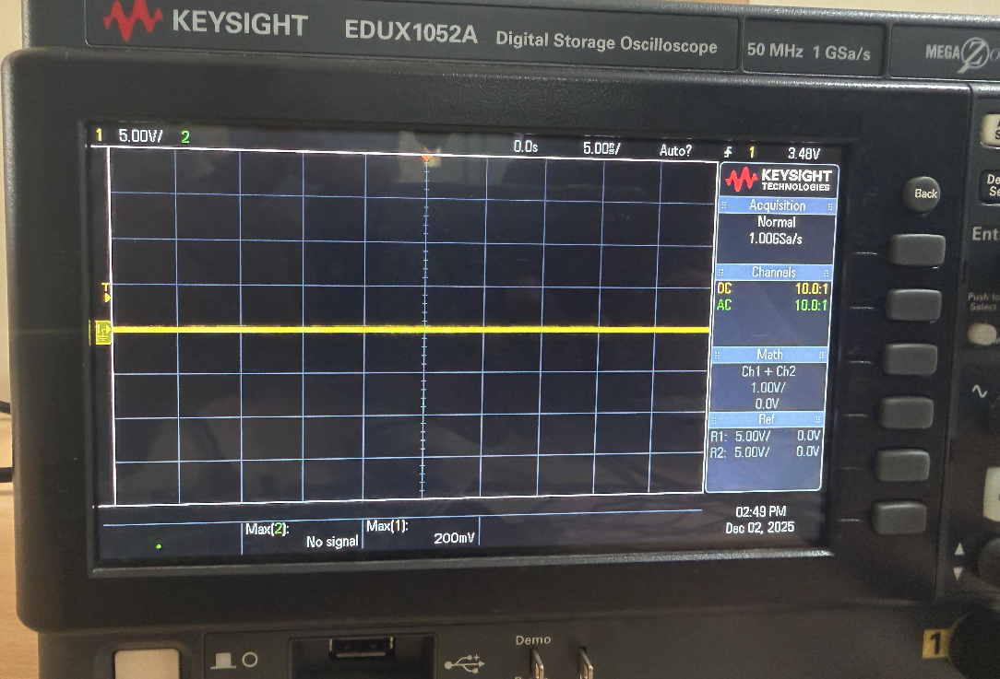 |

---

## Repository Structure

```
.
├── course_project_vlsid2025.pdf   # Problem statement
├── docs/
│   ├── report.pdf                 # Full project report
│   └── images/                    # Figures used in this README
├── NGSpice/                       # Pre-layout (schematic) simulation
│   ├── gates.cir                  # INV, NAND, NOR, AND, OR, XOR subcircuits
│   ├── dff.cir                    # TSPC D-FF with tcq / setup / hold measurements
│   ├── cla.cir                    # Full registered 5-bit CLA adder
│   └── TSMC_180nm.txt             # 180 nm device models
├── Magic/                         # Full-custom layout and extracted netlists
│   ├── *.mag                      # Layouts: inverter, nandgate, norgate, xor_tg, dff,
│   │                              #   pgblock, clablock, sumblock, 5ipregister, finalcircuit
│   ├── *.ext                      # Extraction output
│   ├── *.spice                    # Post-layout SPICE netlists (with parasitics)
│   └── SCN6M_DEEP.09.tech27       # MAGIC technology file
└── Verilog/                       # HDL and FPGA
    ├── gates_and_dff.v            # Basic gate and DFF modules
    ├── cla.v                      # pgblock, clablock, sumblock, clacomb, clasyn (registered top)
    ├── cla_tb.v                   # Testbench
    ├── cla.vcd                    # Simulation dump
    ├── gtkwave_op.png             # GTKWave waveform
    ├── basys3.xdc                 # Pin constraints for Digilent Basys 3
    └── nexysa7.xdc                # Pin constraints for Digilent Nexys A7
```

---

## Getting Started

### Prerequisites

- [NGSPICE](https://ngspice.sourceforge.io/)
- [MAGIC VLSI](http://opencircuitdesign.com/magic/)
- [Icarus Verilog](https://steveicarus.github.io/iverilog/) and [GTKWave](https://gtkwave.sourceforge.net/)
- [Xilinx Vivado](https://www.xilinx.com/products/design-tools/vivado.html) for the FPGA flow

### 1. Schematic simulation (NGSPICE)

```bash
cd NGSpice
ngspice gates.cir   # individual gates
ngspice dff.cir     # flip-flop timing (tcq, setup, hold)
ngspice cla.cir     # full registered CLA adder
```

### 2. Layout and post-layout simulation (MAGIC)

```bash
cd Magic
magic -T SCN6M_DEEP.09.tech27 finalcircuit.mag
```

Inside MAGIC, extract the netlist with:

```tcl
extract all
ext2spice cthresh 0 rthresh 0
ext2spice
```

Then simulate the generated `.spice` file in NGSPICE and compare it with the schematic results.

### 3. Verilog simulation

```bash
cd Verilog
iverilog -o cla cla.v cla_tb.v
vvp cla
gtkwave cla.vcd
```

The testbench adds `a = 10101` (21) and `b = 01010` (10) with `cin = 0`, which gives `sum = 11111` (31) and `cout = 0`.

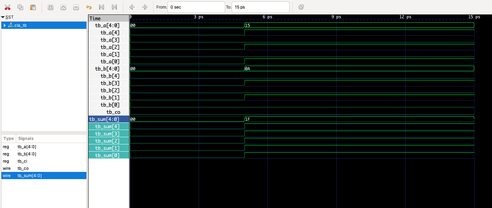

### 4. FPGA implementation

1. Create a Vivado project and add `Verilog/cla.v`.
2. Set **`clasyn`** as the top module (registered inputs and outputs).
3. Add `basys3.xdc` or `nexysa7.xdc`, depending on your board.
4. Synthesize, implement, generate the bitstream and program the board.

Basys 3 mapping:

| Signal | Board I/O |
|---|---|
| `clk` | 100 MHz on-board oscillator (W5) |
| `a_in[4:0]` | Switches SW0–SW4 |
| `b_in[4:0]` | Switches SW11–SW15 |
| `sum_out[4:0]` | LEDs LD0–LD4 |
| `cout_out` | LED LD5 |

---

## Deliverables Covered

- [x] Adder architecture and block-level design
- [x] Topology and sizing of every block
- [x] NGSPICE functional verification of each block
- [x] D flip-flop setup time, hold time and clock-to-Q delay
- [x] MAGIC layouts of each gate and block, with extraction
- [x] Full-circuit integration and simulation
- [x] Full-chip layout and post-layout simulation
- [x] Structural Verilog and simulation
- [x] FPGA implementation

---

## References

1. M. Morris Mano, *Digital Logic and Computer Design*
2. John P. Hayes, *Computer Architecture and Organization*
3. N. Weste and D. Harris, *CMOS VLSI Design*, 4th ed.
4. S. Brown and Z. Vranesic, *Fundamentals of Digital Logic with Verilog Design*
5. J. M. Rabaey, A. Chandrakasan and B. Nikolić, *Digital Integrated Circuits: A Design Perspective*, 2nd ed.
6. J. Yuan and C. Svensson, "New single-clock CMOS latches and flip-flops with improved speed and power savings," *IEEE JSSC*, 1997

## Acknowledgements

Thanks to Prof. Abhishek Srivastava and the course Teaching Assistants for their guidance and support throughout the project.

---

## Author

**Gaurav Reddy Yerreddi** · Electronics & Communication Engineering, IIIT Hyderabad · [@gauravv-13](https://github.com/gauravv-13)
